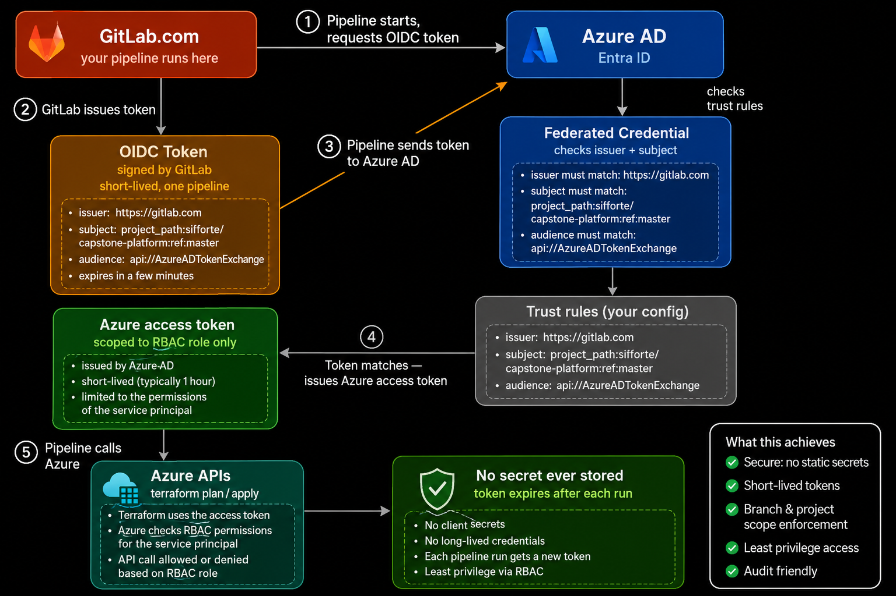
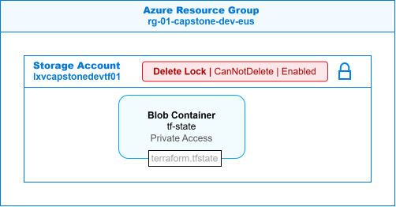
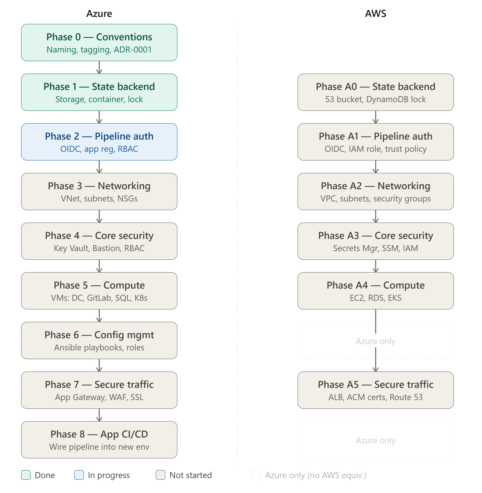

# Azure DevSecOps Platform

> A secure, repeatable Azure platform built entirely with Terraform and deployed through a GitLab CI/CD pipeline that authenticates with OIDC — no stored cloud credentials anywhere.

**Status:** Phases 0–3 complete · Phase 4 (secrets) in progress · Built and documented as a personal engineering capstone.

> **Note:** This GitHub repository is a read-only mirror. Development and all CI/CD pipelines run on GitLab.

---

## Business problem

Teams that build cloud environments by hand end up with environments that drift, access that nobody can audit, and long-lived credentials sitting in CI variables. This platform answers three questions a security-conscious team would ask:

1. Can every environment be rebuilt from code, reviewed before it changes, and traced afterward?
2. Can the pipeline deploy to Azure without anyone storing a secret?
3. Is every network path and permission a deliberate, documented decision?

## Architecture



*GitLab CI requests a short-lived OIDC token, Entra ID validates it against a federated credential scoped to this project's `master` branch, and the pipeline receives an Azure access token for that run only.*



*Remote state lives in a dedicated storage account with versioning, soft delete, and a `CanNotDelete` resource lock.*



## What's built

| Phase | Scope | Status |
|---|---|---|
| 0 | Naming and tagging conventions ([ADR-0001](docs/adr/0001-name-and-tagging.md)) | Done |
| 1 | Remote state backend: storage account with versioning, soft delete, `CanNotDelete` lock | Done |
| 2 | Pipeline identity: Entra ID app registration, service principal, OIDC federated credential, scoped RBAC ([ADR-0003](docs/adr/0003-pipeline-identity-and-rbac.md)) | Done |
| 3 | Networking: reusable Terraform module, six-subnet design, NSG rule matrix, Bastion subnet design ([ADR-0002](docs/adr/0002-network-and-security-design.md)) | Done |
| 4 | Secrets: Azure Key Vault module (RBAC model, private endpoint only) | In progress |
| 5 | Compute provisioning | Planned |
| 6 | Configuration management (Ansible) | Planned |
| 7 | Secure ingress (Application Gateway + WAF) | Planned |
| 8 | Security scanning in CI: SAST, SCA, container scanning, SBOM | Planned |

## Key decisions

Every significant choice is recorded as an Architecture Decision Record in [`docs/adr/`](docs/adr/).

- **OIDC federation instead of a client secret.** The pipeline never holds a long-lived credential. Tokens are minted per run and scoped to the `master` branch, so the real security boundary is who can run a pipeline on `master` — which is why that branch is protected.
- **Hardened state backend.** Terraform state contains every resource's details, so the storage account is protected against both accidental deletion (resource lock) and bad writes (blob versioning and soft delete).
- **Accepted risk, documented with a trigger.** The pipeline identity currently has Contributor at subscription scope to unblock the initial build. That's broader than least privilege, so ADR-0003 records the risk and the condition that triggers tightening it to resource-group scope.
- **Key Vault before HashiCorp Vault.** A managed service with Azure RBAC covers the platform's secrets through the build phase. Running a Vault cluster is deferred until there are enough real application secrets to justify the operational cost.

## Repository layout

```
src/azure/
├── bootstrap/            # One-time setup: state backend + pipeline identity
├── environments/dev/     # Dev environment composition
└── modules/              # Reusable modules (networking, secrets, ...)
docs/
├── adr/                  # Architecture Decision Records
└── build-log.md          # What was built, when, and what broke along the way
evidence/diagrams/        # Architecture diagrams
.gitlab-ci.yml            # Plan runs when job specific files change, manual-gated apply
```

## Pipeline

- Pipelines run on `master` only.
- Jobs run only when their code changes:
  - **Bootstrap** jobs: files under `src/azure/bootstrap/`
  - **Dev** jobs: files under `src/azure/environments/dev/` or `src/azure/modules/`
  - Documentation-only commits don't start a pipeline.
- `terraform fmt -check` and `terraform validate` run before every plan.
- **Plan** runs automatically. **Apply** is a manual gate and uses the exact plan file from its plan job, so what was reviewed is what gets applied.
- Plan and apply share a single rule definition (a YAML anchor), so an apply job can never appear without its plan.
- Shared job settings live in hidden jobs reused with `extends`.
- Authentication is OIDC end to end. The pipeline has no Azure secret to leak.

## Production gaps

This is a lab environment. Before running it for real, I would:

- Tighten the pipeline identity from subscription-scope Contributor to resource-group scope (tracked in ADR-0003).
- Enable Key Vault purge protection (disabled now so the vault can be rebuilt quickly during development).
- Add policy-as-code checks (Checkov or OPA) that block non-compliant changes before apply.
- Add a separate production environment with its own approval rules.
- Disable shared-key access on the state storage account and require Entra ID authentication.
- Scheduled drift detection: a nightly plan that flags out-of-band changes.

## Lessons learned

The full record is in [`docs/build-log.md`](docs/build-log.md). One example: an NSG rule failed to apply because Azure's `destination_port_range` (single value) and `destination_port_ranges` (list) are separate fields, and setting the wrong one produced an API error rather than a validation error.

## How it's deployed

1. `src/azure/bootstrap/` is applied once to create the state backend and the pipeline identity.
2. GitLab CI authenticates to Azure with OIDC. The project stores three CI/CD variables
   (names only; values live in GitLab): `AZURE_CLIENT_ID`, `AZURE_TENANT_ID`, `AZURE_SUBSCRIPTION_ID`.
   The pipeline maps them to the Terraform provider's `ARM_*` variables, sets `ARM_USE_OIDC=true`,
   and GitLab issues each job a short-lived `ARM_OIDC_TOKEN`.
3. Every infrastructure change is planned in the pipeline; apply is a manual gate on `master`.